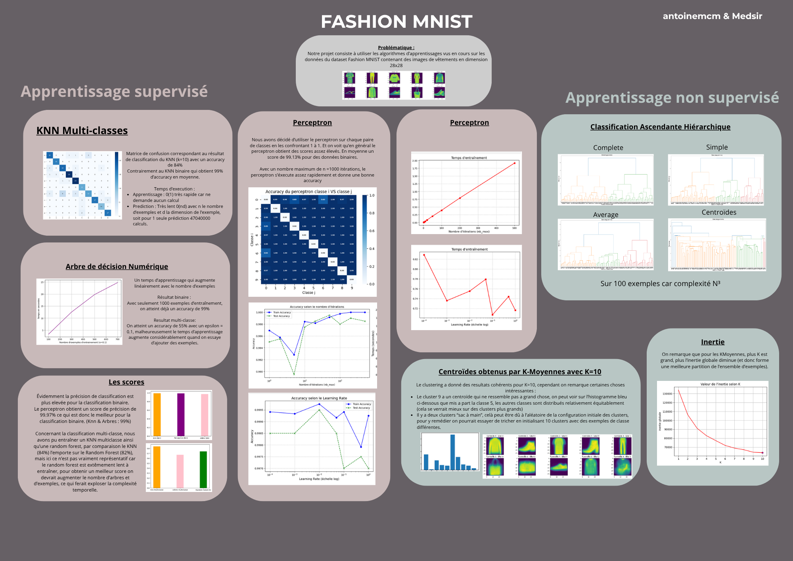

# Fashion Mnist

Ceci est un projet de Data science universitaire réalisé par antoinemcm (moi, Antoine M.) et Medsir (Mehdi). 
Nous avons implémenté une librairie de data science avec plusieurs classifieurs pour différents types d'apprentissages (supervisés / non supervisés)
La librairie en question ne sera pas partagée mais le rendu final du projet est disponible dans Projet/projet.ipynb si vous souhaitez voir comment nous avons
pu utiliser nos classifieurs sur la base de données [Fashion MNIST](https://fr.wikipedia.org/wiki/Fashion_MNIST) ainsi que l'analyse de performances.

